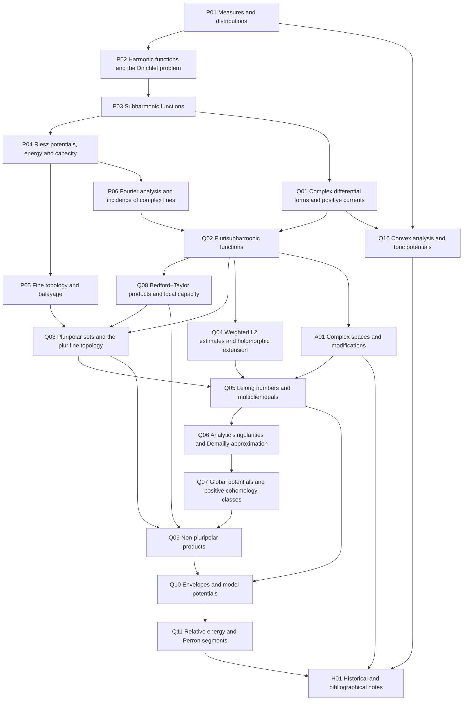

# Chapter prerequisite graph

Generated by `make progress` from the required rows in `plan/chapters.json`. Excluded historical units are omitted. Arrows point from a prerequisite to its consumer.

This is a planning graph, not a complete result-level proof graph. Appendix A may be consulted when its internal tools first arise; its printed placement does not put it after its consumers in logical order. SGPT is not a proof input.

